# Math Coach: state and workflow model

The states and transitions behind the use cases in `docs/USE-CASES.md` (ids in brackets). Every threshold and
rule here is read from the code (file references given); diagrams are Mermaid and render on GitHub.
As of 2026-11-13 (step053).

## 1. The daily loop (end to end)

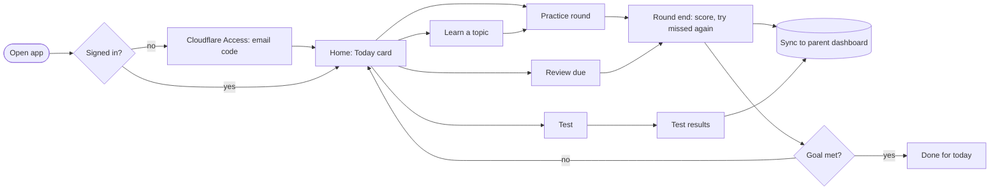

Use cases: A1, B1–B18, C1–C6, E1–E2, F3.

## 2. One problem card (coaching)

`core/coach.ts` (`maxTries = 2`), `ui/problemCard.ts`. [B4–B7, B10]

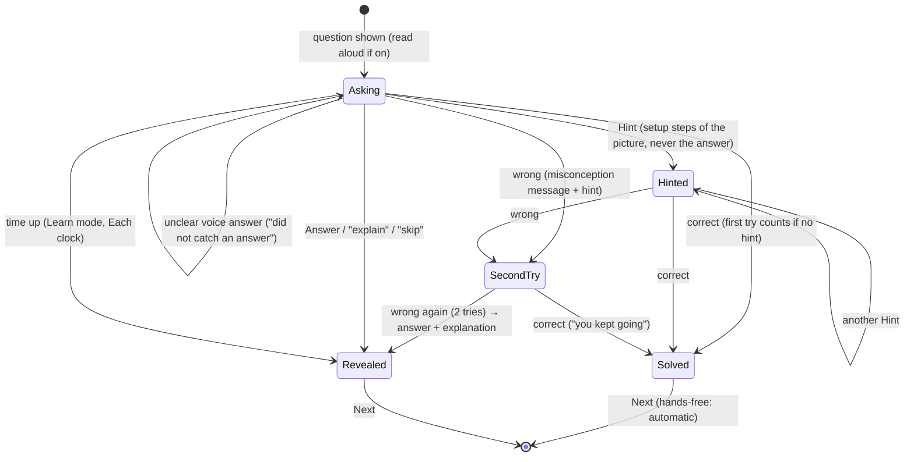

Outcome recorded: `correct`, `firstTry` (correct, no hint, first try), `hints`, `seconds`, first wrong answer.
A card that ends **Revealed** or not on the first try goes to Review (§4).

## 3. A practice round

`screens/practice.ts`, `ui/roundEnd.ts`, `state.rounds`. [B2, B11–B14, B17]

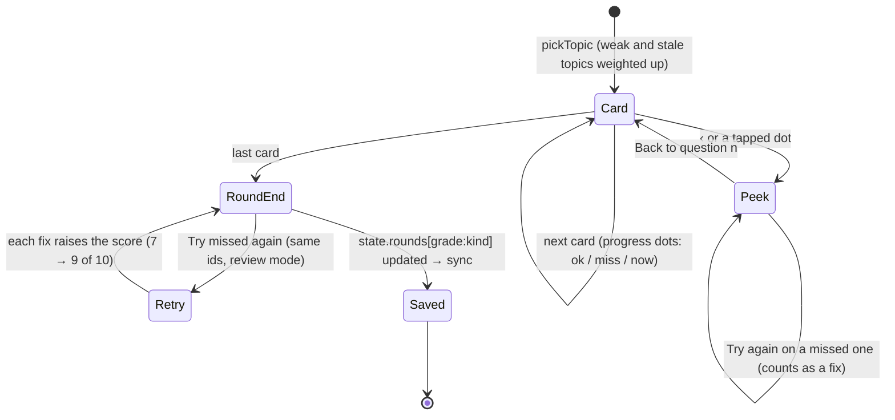

Topic weights (`core/mastery.pickTopic`): untried 1.6; tried `0.25 + (1 − mastery) × 1.5 + min(staleDays, 7) × 0.08`;
the previous topic is avoided.

## 4. Spaced review (Leitner boxes)

`core/storage.ts` (`BOX_DAYS = [0, 0, 1, 3, 7, 14]`, indexed by box: box 2 waits 1 day, box 3 3, box 4 7, box 5 14; box 1 and a wrong answer are due now). [B18]

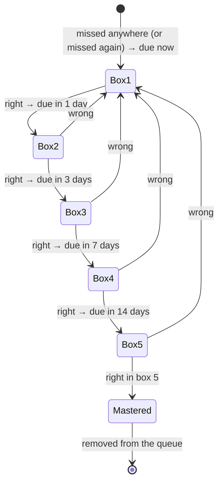

Only items for the current grade that are due show on Home (Review count) and the app badge (G3).

## 5. Mastery, level and stars

`core/storage.recordAttempt`, `core/mastery.levelFor`, `core/progress.STAR_RULES`. [B15]

- **Mastery** after each attempt: `m ← 0.75·m + 0.25·(correct ? 1 : 0)`.
- **Level** (difficulty of the next problem): fewer than 2 attempts → 1; mastery ≥ 0.8 and ≥ 4 attempts → 3;
  mastery ≥ 0.5 → 2; else 1.
- **Stars** never go down:

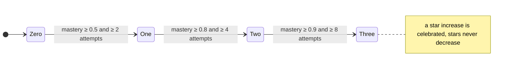

## 6. Tests

`screens/test.ts`, `core/session.ts`. [C1–C6]

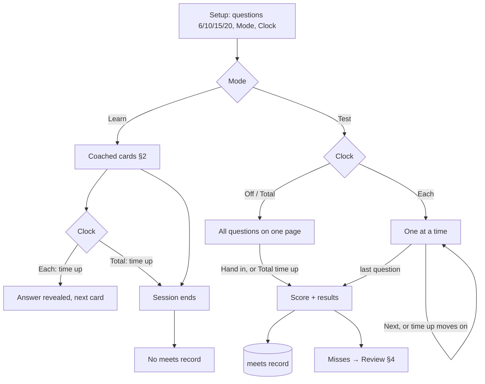

Only **Test mode** writes a `meets` record (Progress, parent chart). The last minute of a clock warns (and is
announced when read-aloud is on).

## 7. Parent dashboard, sync and family data

`server/parent.ts`, `sync/sync.ts`, `screens/settings.ts`, `screens/parent.ts`. [F1–F10]

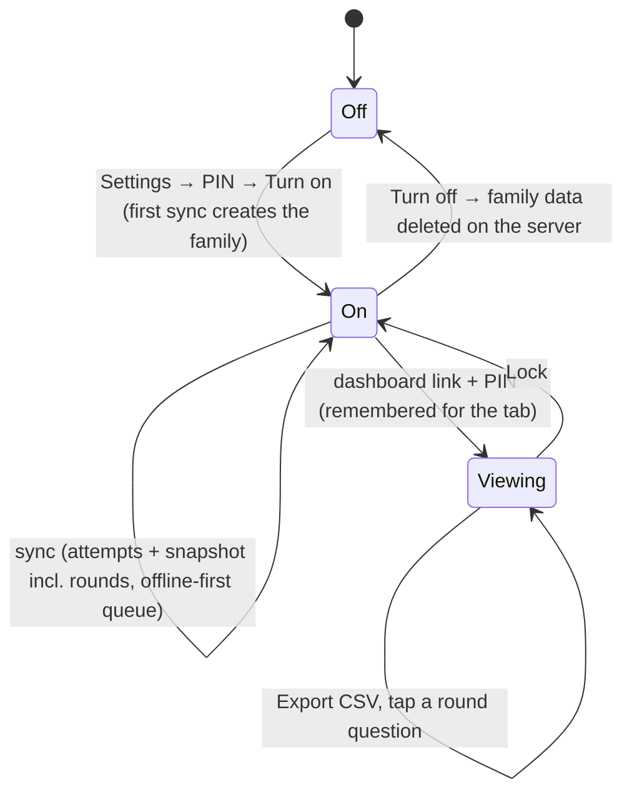

## 8. Parent email

`server/email.ts` (`TOKEN_DAYS = 3`, `NUDGE_AFTER_DAYS = [3, 7]`, `NUDGE_HOUR = 17`), `server/digest.ts`. [F11–F15]

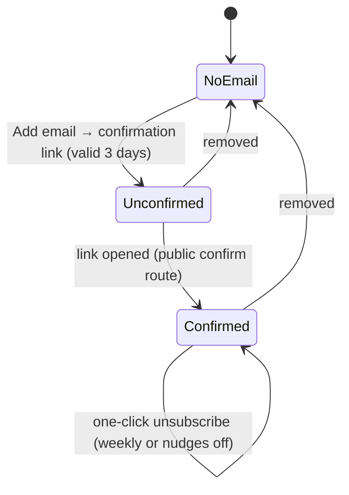

Nudges: the first after **3** idle days, the second after **7**, at most 2 per break, only at **5 pm America/Chicago**,
never on Sunday; practising again resets the count.

## 9. Device reminders (web push)

`notify/reminders.ts`, `server/push.ts`, `functions/api/hourly.ts`. [G1–G3]

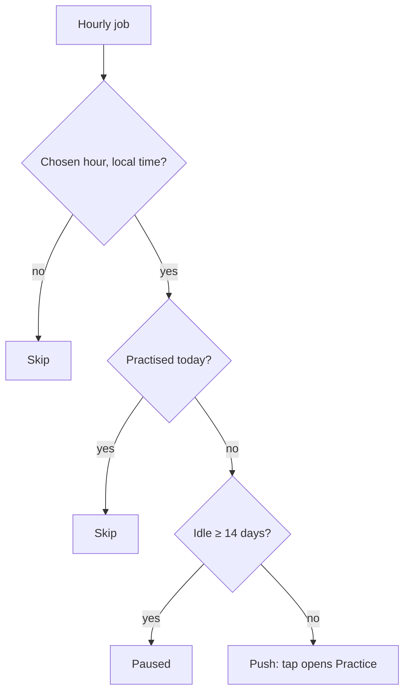

Opt-in in Settings, hours 6–21, at most one a day; on iPad only from the Home Screen app.

## 10. Feedback triage

`ui/feedbackSheet.ts`, `server/userFeedback.ts`, `scripts/feedback.mjs`. [H1–H4]

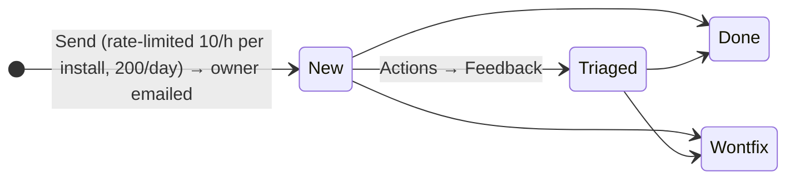

Message text never goes into GitHub (issues or logs).

## 11. App version and sign-in

`src/pwa.ts`, `public/push-sw.js`. [A1–A3]

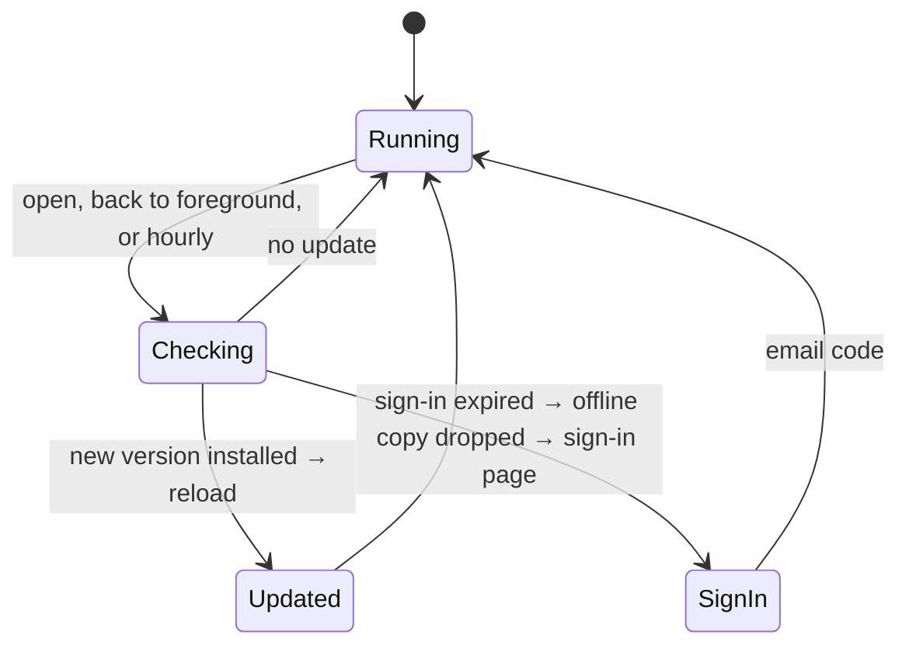

## 12. Scheduled jobs

`.github/workflows/hourly.yml` → `POST /api/hourly` (bearer `CRON_SECRET`); each part decides if it is due:
weekly digest (§8), nudges (§8), device reminders (§9). Deploys: push to `main` → check → D1 migrations →
Pages → smoke tests → custom-domain check (H6).
